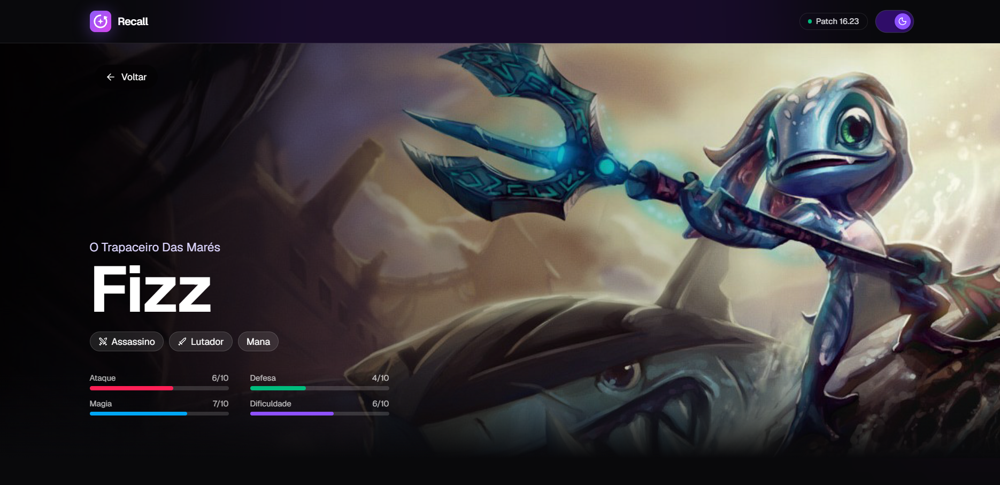

<p align="center">
  
</p>

<h1 align="center">Recall</h1>

<p align="center">
  Biblioteca de campeões do League of Legends: história, habilidades, dicas e skins de cada campeão, sempre no patch atual.
</p>

<p align="center">
  <a href="https://recall-web-lake.vercel.app"><strong>Acesse o Recall</strong></a>
  ·
  <a href="https://github.com/JoaoLucasmcS/recall-api">Recall API</a>
</p>

<p align="center">
  <sub>Hospedagem gratuita: se ninguém usou o site nos últimos minutos, a primeira visita pode levar até um minuto enquanto o servidor acorda.</sub>
</p>

<p align="center">
  
</p>

## Funcionalidades

- **Biblioteca** com todos os campeões do patch atual, busca por nome e filtro por classe (marcando mais de uma classe, mostra só quem tem todas, como Mago + Assassino)
- **Página do campeão** com splash art, atributos, história, passiva e habilidades (Q/W/E/R) com recarga e custo, dicas para jogar com e contra, e galeria de skins
- **Tema claro e escuro**, com a escolha salva no navegador
- **Layout responsivo**, pensado também para o celular
- **Página 404** personalizada
- Versão do patch atual na barra de navegação

<p align="center">
  
</p>

## Stack

- **React 19** + **TypeScript** + **Vite**
- **Tailwind CSS v4** e componentes **shadcn/ui**
- **React Router** para as rotas (`/`, `/campeao/:id` e 404)
- Ícones **lucide-react**

Os dados vêm da [Recall API](https://github.com/JoaoLucasmcS/recall-api), um BFF em FastAPI que consome o Data Dragon da Riot, faz cache por patch e entrega os dados prontos para a tela.

## Organização

```
src/
├── pages/        Biblioteca e Campeao (uma por rota)
├── components/   peças da interface (cards, navbar, filtros, seções do campeão)
│   └── ui/       componentes gerados pelo shadcn
├── hooks/        busca de dados e tema (useCampeoes, useCampeao, usePatch, useTema)
├── lib/          chamada à API, tradução das classes, limpeza de texto
└── types/        tipos dos dados que a API devolve
```

Toda chamada à API passa por `lib/api.ts`, o único lugar que conhece o endereço da API e trata respostas de erro.

## Como rodar

Com a [Recall API](https://github.com/JoaoLucasmcS/recall-api) rodando em `http://127.0.0.1:8000`:

```bash
npm install
npm run dev     # abre em http://localhost:5173
```

O endereço da API fica em `.env.development` (`VITE_API_URL`).

## Próximos passos

- **Pergunte ao Recall:** assistente com IA que responde sobre os campeões usando os dados reais da API (tool calling), com servidor MCP e RAG sobre as notas de patch

---

Recall não é endossado pela Riot Games e não reflete as opiniões da Riot Games nem de ninguém oficialmente envolvido na produção ou gestão de League of Legends. League of Legends e Riot Games são marcas comerciais ou marcas registradas da Riot Games, Inc. League of Legends © Riot Games, Inc.
